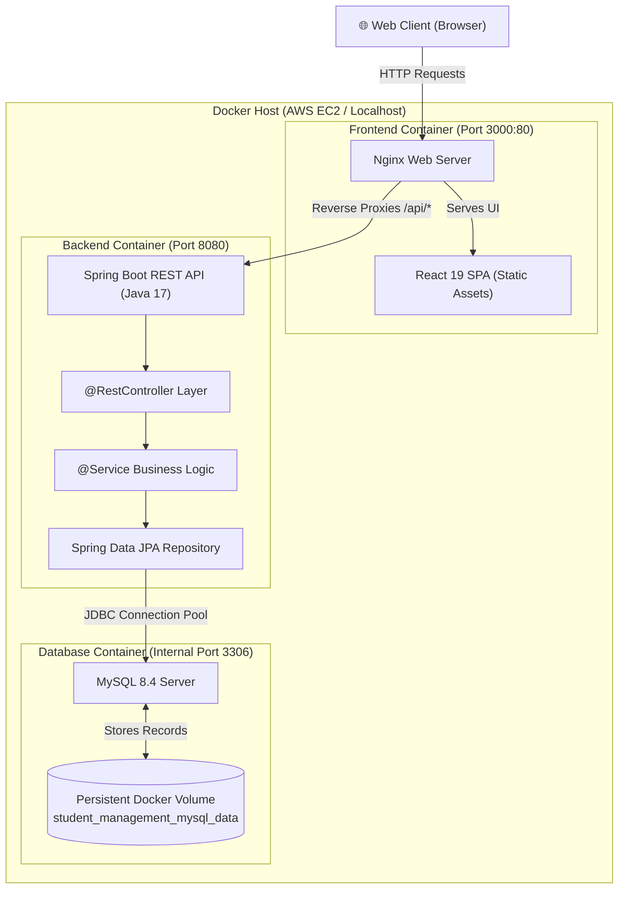

# Student Management System

A production-grade, containerized full-stack web application built with **React**, **Java 17 / Spring Boot**, **MySQL**, **Docker Compose**, and deployed on **Amazon EC2**.

---

## 🏗️ Architecture Overview

The application follows an enterprise **3-Tier Microservices-ready Architecture** orchestrated with Docker Compose:



### Security & Networking Highlights
- **Shielded Database Port**: MySQL listens only on `127.0.0.1:3307` locally and internal container networking `mysql:3306`. It is **never exposed publicly** to the internet on AWS EC2.
- **Nginx Reverse Proxy**: The frontend container serves compiled static assets and proxies all `/api/` traffic directly to the Spring Boot backend container, eliminating Cross-Origin Resource Sharing (CORS) complications in production.
- **Persistent Data Volume**: Database records are written to a Docker named volume (`student_management_mysql_data`), surviving container restarts and upgrades.

---

## 🛠️ Technology Stack

| Layer | Technology | Details |
| :--- | :--- | :--- |
| **Frontend** | React 19, Vite, Axios | Responsive dashboard, live debounced search, profile modals, inline validation |
| **Backend** | Java 17, Spring Boot | Layered architecture (DTOs, Service, JPA Repository, Global Exception Handler) |
| **Database** | MySQL 8.4 | Relational persistence, HikariCP connection pooling, Hibernate DDL |
| **Web Server** | Nginx Alpine | Lightweight reverse proxy and static asset server |
| **Containerization** | Docker, Docker Compose | Multi-stage Dockerfiles for minimal image footprint and fast build times |
| **Cloud Hosting** | Amazon Web Services (AWS) | Amazon EC2 Linux instance with security groups and Docker Engine |

---

## 📋 REST API Endpoints

All endpoints are hosted under `/api/students` and `/api/health`.

| Method | Endpoint | Description | Request Body | Success Code |
| :--- | :--- | :--- | :--- | :---: |
| `GET` | `/api/health` | Health-check endpoint for container monitoring | None | `200 OK` |
| `GET` | `/api/students` | Retrieve all registered student records | None | `200 OK` |
| `GET` | `/api/students/{id}` | Retrieve single student profile by primary ID | None | `200 OK` |
| `GET` | `/api/students/search?query=...` | Search students by ID, Roll No, Name, Dept, or Course | None | `200 OK` |
| `POST` | `/api/students` | Register a new student record (with Bean Validation) | `StudentRequestDto` | `201 Created` |
| `PUT` | `/api/students/{id}` | Update existing student profile information | `StudentRequestDto` | `200 OK` |
| `DELETE` | `/api/students/{id}` | Permanently delete a student record | None | `200 OK` |

### Sample Student JSON Payload
```json
{
  "studentId": "STU-1001",
  "name": "Jane Doe",
  "email": "jane.doe@university.edu",
  "department": "Computer Science & Engineering",
  "course": "B.Tech AIML",
  "yearOfStudy": 3
}
```

---

## ⚙️ Environment Variables Configuration

Copy `.env.example` to `.env` to configure your environment:

```bash
cp .env.example .env
```

| Variable | Default Value | Description |
| :--- | :--- | :--- |
| `MYSQL_DATABASE` | `studentdb` | Initial database name |
| `MYSQL_USER` | `studentuser` | Dedicated application database user |
| `MYSQL_PASSWORD` | `studentpass123` | Password for application user |
| `MYSQL_ROOT_PASSWORD` | `root123` | MySQL administrative root password |
| `MYSQL_PORT` | `3307` | Host port binding for MySQL (bound to `127.0.0.1`) |
| `BACKEND_PORT` | `8080` | Host port binding for Spring Boot API |
| `FRONTEND_PORT` | `3000` | Host port binding for React/Nginx UI |
| `SPRING_JPA_HIBERNATE_DDL_AUTO` | `update` | Hibernate schema management mode |

---

## 🚀 Quickstart: Running Locally with Docker Compose

### Prerequisites
- [Docker Desktop](https://www.docker.com/products/docker-desktop/) installed and running.
- [Git](https://git-scm.com/) installed.

### 1. Clone & Navigate to Project
```bash
git clone https://github.com/<your-username>/student-management-system.git
cd student-management-system
```

### 2. Configure Environment
```bash
cp .env.example .env
```

### 3. Build & Launch Containers
```bash
docker-compose up -d --build
```

### 4. Verify Services
```bash
docker-compose ps
```
All 3 containers (`student-mysql`, `student-backend`, `student-frontend`) should display `Up` status.

### 5. Access the Application
- **Frontend Dashboard**: Open [http://localhost:3000](http://localhost:3000) in your browser.
- **Backend Health Check**: Open [http://localhost:8080/api/health](http://localhost:8080/api/health).
- **Backend Students API**: Open [http://localhost:8080/api/students](http://localhost:8080/api/students).

---

## 🐳 Docker Management & Troubleshooting Commands

| Command | Purpose |
| :--- | :--- |
| `docker-compose up -d --build` | Rebuild images and start all services in detached mode |
| `docker-compose ps` | Check container statuses, health, and exposed ports |
| `docker-compose logs -f` | Stream live aggregated logs from all services |
| `docker-compose logs -f backend` | Stream logs specifically from Spring Boot backend |
| `docker-compose restart` | Restart all running containers without destroying them |
| `docker-compose down` | Stop and remove containers and internal bridge network |

> ⚠️ **CAUTION ON `-v` FLAG**:
> Running `docker-compose down -v` removes all Docker named volumes including `mysql_data`. Never use `-v` in production unless you intentionally want to delete all stored database records.

---

## ☁️ AWS EC2 Deployment Guide

### 1. Launch EC2 Instance
- **AMI**: Ubuntu Server 24.04 LTS (HVM), SSD Volume Type.
- **Instance Type**: `t2.small` or `t3.small` (recommended: 2 vCPU, 2 GiB RAM for running Java + MySQL smoothly) or `t2.micro` with swap space enabled.
- **Key Pair**: Create and download your `.pem` key (e.g., `student-key.pem`).

### 2. Security Group Configuration
Configure inbound firewall rules in the AWS Console:
- **SSH (Port 22)**: Source -> `My IP` (recommended for security)
- **HTTP (Port 80 / 3000)**: Source -> `0.0.0.0/0` (Allows web access)
- **Custom TCP (Port 8080)**: Source -> `0.0.0.0/0` (Allows API access)
- **DO NOT open Port 3306/3307 to the public!**

### 3. Connect via SSH
```bash
chmod 400 student-key.pem
ssh -i "student-key.pem" ubuntu@<YOUR-EC2-PUBLIC-IP>
```

### 4. Install Docker & Docker Compose on Ubuntu
```bash
# Update package lists
sudo apt update && sudo apt upgrade -y

# Install Docker
sudo apt install -y docker.io docker-compose-v2

# Add ubuntu user to docker group
sudo usermod -aG docker $USER
newgrp docker

# Verify installation
docker --version
docker compose version
```

### 5. Clone Project & Run on EC2
```bash
git clone https://github.com/<your-username>/student-management-system.git
cd student-management-system

# Create production .env
cp .env.example .env

# Build and start in detached mode
docker compose up -d --build
```

### 6. Verify Live Deployment
Visit your EC2 Public IP address in your browser:
```text
http://<YOUR-EC2-PUBLIC-IP>:3000
```

---

## 🎓 Resume Highlights & Interview Talking Points

- **3-Tier Decoupled Architecture**: Designed clean separation between presentation (React 19), business logic (Spring Boot 17 REST API), and persistence (MySQL 8.4).
- **Production Containerization**: Created optimized multi-stage Dockerfiles (`eclipse-temurin:17-jre` and `node:24-alpine` -> `nginx:alpine`), slashing container image sizes by ~70%.
- **Reverse Proxying**: Implemented Nginx reverse proxy configuration to eliminate browser CORS overhead and streamline client-side API requests.
- **Data Persistence & Isolation**: Hardened MySQL against network exposure by binding to loopback only and implementing Docker named volume persistence.
- **Enterprise Error Handling**: Built `@RestControllerAdvice` centralized exception architecture with structured RFC JSON responses and bean validations.
